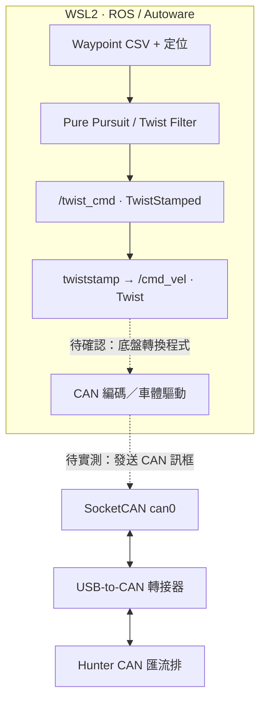

# Hunter 實車連線測試｜Windows 11 + WSL2 + USB-to-CAN

這份文件記錄 Hunter 移動機器人在 **Windows 11／WSL2（Ubuntu 18.04、ROS Melodic）** 的硬體連線驗證流程。

文件的目標是讓第一次接手的學弟能依序完成設定、知道每一步為什麼要做，以及判斷目前是否成功。**本專案與 [Autoware-Lite 離線版](https://github.com/SeaFu/autoware-lite) 分開**；這裡不需要 ROS bag 播放功能。

> [!CAUTION]
> **目前這是一份實車「連線與唯讀診斷」指南，不是可直接讓 Hunter 自駕的操作手冊。**
>
> CAN 封包可能關係到車體驅動、煞車與安全狀態。本文不提供 `cansend`、速度指令注入或解除保護機制的操作。測試時先讓車輪離地／置於不會移動的安全狀態，保留原廠急停與遙控器，並由熟悉車體的人員在場。
>
> 看到 `can0` 不代表已收到 CAN 封包；收到 CAN 封包也不代表 Autoware 已經可以控制底盤。

## 目錄

1. [已完成哪些測試](#1-已完成哪些測試)
2. [整體通訊架構：ROS、Twist、CAN 的關係](#2-整體通訊架構rostwistcan-的關係)
3. [另一台電腦是否需要重編 WSL2 核心](#3-另一台電腦是否需要重編-wsl2-核心)
4. [Windows 11：安裝 USBIPD 並確認設備](#4-windows-11安裝-usbipd-並確認設備)
5. [方式 A：沿用已編好的 CAN 核心（推薦）](#5-方式-a沿用已編好的-can-核心推薦)
6. [方式 B：從原始碼重新編譯核心（選用）](#6-方式-b從原始碼重新編譯核心選用)
7. [USB-to-CAN 分享至 WSL2](#7-usb-to-can-分享至-wsl2)
8. [WSL2：驗證 `can0` 與 CAN 接收](#8-wsl2驗證-can0-與-can-接收)
9. [ROS 與 Autoware 的下一階段驗證](#9-ros-與-autoware-的下一階段驗證)
10. [常見問題與還原方式](#10-常見問題與還原方式)

---

## 1. 已完成哪些測試

以下記錄的是先前在原始測試筆電上觀察到的結果；**其他電腦需要重新驗證**。

| 項目 | 已知結果 | 可以證明什麼 |
| --- | --- | --- |
| Windows 11 將 USB-to-CAN 分享給 WSL2 | `usbipd attach --wsl` 成功 | USB 裝置已轉交 WSL2 |
| WSL2 辨識 USB 裝置 | `lsusb` 顯示 `1d50:606f OpenMoko, Inc.` | Linux 看得到 USB-to-CAN 轉接器 |
| 舊版 WSL 核心 | `# CONFIG_CAN is not set`、`modprobe gs_usb` 失敗 | 原核心缺少所需 CAN／`gs_usb` 功能 |
| 自行編譯 WSL 核心 | `uname -r` 顯示 `5.15.167.4-microsoft-standard-WSL2+` | 已成功載入自訂核心 |
| 核心 CAN 功能 | `CONFIG_CAN`、`CAN_RAW`、`CAN_DEV`、`CAN_GS_USB` 均為 `y` | 所需功能已內建在核心 |
| SocketCAN 介面 | `ip -br link` 顯示 `can0` | USB-to-CAN 已建立 Linux CAN 介面 |
| CAN 封包 | 使用者表示已在 WSL2 讀到訊號 | 尚須在另一台電腦以 `candump` 和實際封包記錄複驗 |
| ROS `/twist_cmd → /cmd_vel` | 有原版 `twiststamp` 與較安全的修正版程式 | 只能確認訊息轉換程式存在，**尚非實車閉迴路驗證** |
| ROS `/cmd_vel → CAN → Hunter` | 尚未確認負責轉換的程序、CAN ID、封包格式 | **不可宣稱已完成實車控制** |

### 已知硬體資訊

- USB-to-CAN：Windows 裝置列表曾顯示 `candleLight (USB to CAN adapter)`。
- USB VID:PID：`1d50:606f`（Linux 顯示 `OpenMoko, Inc.`；辨識名稱不一定直接寫 CAN）。
- 原機上的 Windows BUSID 曾為 `2-5`，**不是固定值**。
- Ubuntu WSL 發行版名稱：`Autoware-18.04`，原機為 WSL2。
- 改過的 WSL 核心：`5.15.167.4-microsoft-standard-WSL2+`。
- **Hunter 的 CAN bitrate、CAN ID 與控制封包格式，目前未從交接文件或實際封包確認，本文不猜測。**

## 2. 整體通訊架構：ROS、Twist、CAN 的關係

### 2.1 Autoware 到底輸出什麼？

當 Autoware 已完成定位、載入 Waypoint CSV、啟動 Pure Pursuit 與 Twist Filter：

1. **Pure Pursuit** 依目前位姿與 Waypoint 產生追蹤所需的速度／轉向資訊。
2. **Twist Filter** 處理控制命令，通常發布 `/twist_cmd`（`geometry_msgs/TwistStamped`）。
3. **`twiststamp`** 訂閱 `/twist_cmd`，擷取 `linear.x` 與 `angular.z`，發布 `/cmd_vel`（`geometry_msgs/Twist`）。
4. **仍需要一個獨立的底盤通訊程序**，把 `/cmd_vel` 轉成 Hunter 能理解的 CAN 訊框，送到 `can0`。目前不知道先前交接環境是哪個程序完成這一步，不能只因為過去「能動」就假設是 `twiststamp` 寫入 CAN。

`twiststamp` **不會建立 `can0`，也不會自行對 CAN 匯流排送封包**。

### 2.2 指令流向與感測回傳是兩個方向



- **控制方向**：Autoware → ROS 速度訊息 →（底盤驅動／編碼）→ CAN → Hunter。
- **回傳方向**：Hunter → CAN → USB-to-CAN → WSL2 `can0` →（底盤解碼）→ ROS 車體狀態／里程計。
- **目前已著重完成**：Windows USB 分享、WSL2 自訂 CAN 核心，以及 `can0` 的設備辨識／接收測試。

> [!NOTE]
> VLP-16 使用的是**有線網路／UDP 點雲**，與 USB-to-CAN 是兩條獨立的硬體路徑。本 README 聚焦 USB-to-CAN；VLP-16 的網路 IP、UDP 2368、ROS Velodyne 驅動要另外驗證。

## 3. 另一台電腦是否需要重編 WSL2 核心？

**一般不需要。**如果新電腦也是 **Windows 11 + x86-64 WSL2**，可以優先複製已編好的 `bzImage-can`，再在新電腦的 `.wslconfig` 指定它。

但以下幾種情況要重新編譯或另外確認：

| 情況 | 建議 |
| --- | --- |
| 新電腦同樣為 x86-64、WSL2 可啟動，USB-to-CAN 相同 | **先使用既有 `bzImage-can`**，依第 5 節驗證 |
| 新電腦是 ARM64 | **不能直接使用此 x86-64 核心**；需找對應架構及驅動 |
| WSL 更新後不相容、啟動失敗或其他裝置驅動缺失 | 還原原本 `.wslconfig`，再評估依新版本核心重編 |
| 使用不同的 USB-to-CAN 晶片／驅動 | 須檢查對應 Linux 驅動，不保證 `CONFIG_CAN_GS_USB=y` 能支援 |
| 想確保可以從原始碼重現環境 | 使用第 6 節的自行編譯流程 |

> [!IMPORTANT]
> **WSL 的 Ubuntu 檔案系統與 WSL 核心不是同一件事。**
>
> `wsl --export Autoware-18.04 ...tar` 會備份發行版檔案系統，**不會自動把 Windows 的 `.wslconfig` 或這個自訂核心一起打包**。
>
> `.wslconfig` 是**整台 Windows 主機所有 WSL2 發行版共用**，不是只影響 `Autoware-18.04`。設定之前請保留原本的檔案。

### 已有核心的檔案資訊

提供的 `bzImage-can` 經檔案辨識為：

```text
Linux kernel x86 boot executable, bzImage
version: 5.15.167.4-microsoft-standard-WSL2+
arch: x86-64
```

本次提供檔案的 SHA256：

```text
b8dcad5d360146fe488f168d1c96f8136945990d4859f55aa7dba8d1a930be81
```

**建議透過你自己保存的檔案或可信任的交接管道將 `bzImage-can` 複製到新電腦；不要從不明網站下載別人編譯的核心。**

本倉庫主要保留文件與設定方法，**不把這個未附完整對應原始碼／編譯設定紀錄的核心執行檔直接上傳成公開可下載的發行版本**。

## 4. Windows 11：安裝 USBIPD 並確認設備

如果已有可正常執行的 `usbipd`，**略過安裝，直接做第 4.2 節**。

### 4.1 安裝 `usbipd-win`（二選一）

**方式 A：Windows 安裝精靈（初學者推薦）**

1. 到官方 [usbipd-win Releases](https://github.com/dorssel/usbipd-win/releases)。
2. 下載對應 Windows x64 的 `.msi` 安裝檔。
3. 執行安裝程式，依畫面完成安裝。
4. 安裝後**重新開啟** Windows CMD。

**方式 B：Windows 套件管理員（已熟悉 `winget` 者使用）**

在 **Windows CMD／PowerShell** 執行：

```powershell
winget install --interactive --exact dorssel.usbipd-win
```

兩種方式**只要完成其中一種，不必再執行另一種**。

**確認成功：**

```powershell
usbipd --version

usbipd list
```

- 第一個指令顯示版本號，而不是「`usbipd` 不是內部或外部命令」。
- 第二個指令顯示 `BUSID`、`VID:PID`、`DEVICE`、`STATE` 欄位。

### 4.2 找到 Hunter 的 USB-to-CAN

將 USB-to-CAN 接到 Windows 筆電 USB 埠，打開**系統管理員 PowerShell**：

```powershell
usbipd list
```

原機的**輸出範例**：

```text
BUSID  VID:PID    DEVICE                            STATE
2-5    1d50:606f  candleLight (USB to CAN adapter) Not shared
```

你新電腦的 `BUSID` 可能是 `1-3`、`2-5` 或其他數字。**請以實際畫面上的 `1d50:606f` 那一行為準，不能直接照抄 `2-5`。**

如果看不到轉接器：

1. 確認 USB 線材與裝置供電。
2. 重新插拔，再執行一次 `usbipd list`。
3. 開啟 Windows 裝置管理員確認有沒有辨識到裝置。

## 5. 方式 A：沿用已編好的 CAN 核心（推薦）

**只有手上已有相容的 `bzImage-can`，才執行此節；成功後可直接跳到第 7 節。**

### 5.1 將核心檔案放到新電腦

在 Windows 檔案總管建立：

```text
D:\WSLKernel\
```

將交接取得的核心檔複製到：

```text
D:\WSLKernel\bzImage-can
```

如果你把核心放在 C 槽或其他資料夾，後面 `kernel=...` 的設定也必須跟著更改。

在 **Windows PowerShell** 確認檔案存在，並檢查 SHA256：

```powershell
Test-Path 'D:\WSLKernel\bzImage-can'

Get-FileHash 'D:\WSLKernel\bzImage-can' -Algorithm SHA256
```

**成功判斷：**

- `Test-Path` 顯示 `True`。
- SHA256 與第 3 節列出的值一致。若不一致，先核對檔案來源，**不要直接啟用**。

### 5.2 設定 Windows 共用的 `.wslconfig`

在**Windows PowerShell** 輸入：

```powershell
notepad "$env:USERPROFILE\.wslconfig"
```

若記事本詢問是否新增檔案，選擇「是」。

如果檔案原本已存在，先備份或另外存成 `.wslconfig.backup`，**不要覆寫其他既有設定**。

在 `[wsl2]` 段落加入或修改以下一行：

```ini
[wsl2]
kernel=D:\\WSLKernel\\bzImage-can
```

請注意：

- `kernel` 使用**Windows 絕對路徑**，不是 `/mnt/d/...`。
- `.wslconfig` 中的 `\` 請依範例寫成 `\\`。
- 如果檔案已經有 `[wsl2]`，**不要建立第二個相同的區段**；只加入 `kernel` 設定即可。
- 記事本儲存時，檔名必須是 `.wslconfig`，**不是 `.wslconfig.txt`**。

### 5.3 重新啟動 WSL 核心並驗證

先儲存正在執行的 WSL 工作。在 **Windows CMD 或 PowerShell** 輸入：

```powershell
wsl --shutdown

wsl -d Autoware-18.04
```

> [!WARNING]
> `wsl --shutdown` 會關閉**所有** WSL2 發行版與正在執行的 Linux 工作，不是只重啟 `Autoware-18.04`。

若你匯入的發行版名稱不同，請先用 `wsl --list --verbose` 確認，並把上方 `Autoware-18.04` 換成實際名稱。

進入 **Ubuntu 終端機**後輸入：

```bash
uname -r

zcat /proc/config.gz | grep -E '^CONFIG_CAN=|^CONFIG_CAN_RAW=|^CONFIG_CAN_DEV=|^CONFIG_CAN_GS_USB='
```

原機的**預期輸出**：

```text
5.15.167.4-microsoft-standard-WSL2+
CONFIG_CAN=y
CONFIG_CAN_RAW=y
CONFIG_CAN_DEV=y
CONFIG_CAN_GS_USB=y
```

如果顯示以上內容，代表正在使用自訂 CAN 核心，可以繼續第 7 節。**此時 `can0` 還未必存在**，因為 USB 裝置可能尚未掛載到 WSL。

`CONFIG_CAN_GS_USB=y` 的 `y` 表示**已編入核心**，所以不需要再執行 `sudo modprobe gs_usb`。原本看到 `Module gs_usb not found` 並不代表內建驅動失效。

## 6. 方式 B：從原始碼重新編譯核心（選用）

**方式 A 能成功就不用做這一節。**只有核心檔遺失、版本／架構不相容，或需要重現編譯過程時，才往下執行。

以下以原機曾使用的 Microsoft WSL2 **`5.15.167.4`** 系列為例，適用於 x86-64 的 Ubuntu WSL。其他版本請先確認對應 tag、配置格式與編譯相依套件，**不可直接把新版本核心的設定指令混用**。

### 6.1 在 Ubuntu 安裝編譯工具

```bash
sudo apt update

sudo apt install -y \
  git build-essential flex bison bc \
  libssl-dev libelf-dev dwarves cpio
```

**成功判斷：**安裝命令沒有 `E: Unable to locate package` 或其他失敗訊息。

### 6.2 下載 Microsoft 對應版本核心原始碼

```bash
git clone --depth 1 \
  --branch linux-msft-wsl-5.15.167.4 \
  https://github.com/microsoft/WSL2-Linux-Kernel.git \
  ~/wsl2-can-kernel

cd ~/wsl2-can-kernel

git describe --tags --exact-match
```

**成功判斷：**最後一行顯示 `linux-msft-wsl-5.15.167.4`。

如果 `~/wsl2-can-kernel` 已存在，不要直接刪除或覆寫；先檢查其 Git 狀態與版本。官方來源：[Microsoft WSL2-Linux-Kernel](https://github.com/microsoft/WSL2-Linux-Kernel)。

### 6.3 以 Microsoft 的 WSL 核心設定為基礎，加入 SocketCAN

請確定目前在 `~/wsl2-can-kernel`：

```bash
cp Microsoft/config-wsl .config

scripts/config --enable CAN
scripts/config --enable CAN_RAW
scripts/config --enable CAN_DEV
scripts/config --enable CAN_GS_USB

make olddefconfig
```

這四項功能分別是：

| 核心設定 | 功能 |
| --- | --- |
| `CONFIG_CAN=y` | Linux CAN 協定核心 |
| `CONFIG_CAN_RAW=y` | 使用 SocketCAN Raw Socket（如 `candump`） |
| `CONFIG_CAN_DEV=y` | CAN 網路裝置支援 |
| `CONFIG_CAN_GS_USB=y` | `gs_usb`／candleLight 類 USB-to-CAN 驅動 |

確認設定確實成功：

```bash
grep -E '^CONFIG_CAN=|^CONFIG_CAN_RAW=|^CONFIG_CAN_DEV=|^CONFIG_CAN_GS_USB=' .config
```

**四項均應為 `=y`。**如果出現 `=m` 或某項不見，請先檢查相依選項，不要直接編譯。使用 `=y` 可以避免不同 WSL 發行版找不到對應 `.ko` 模組的問題，但也表示日後更新核心要重新處理版本相容性。

### 6.4 編譯與匯出核心

```bash
make -j2 bzImage

ls -lh arch/x86/boot/bzImage

file arch/x86/boot/bzImage
```

**成功判斷：**`make` 結束沒有 `Error`，且 `arch/x86/boot/bzImage` 存在、`file` 顯示 Linux kernel x86 boot executable。

`-j2` 是較保守的並行數量，可降低 WSL 記憶體不足的風險。效能較好的電腦可以自行調整。

如果 D 槽存在並已掛載：

```bash
mkdir -p /mnt/d/WSLKernel

cp arch/x86/boot/bzImage /mnt/d/WSLKernel/bzImage-can

sha256sum /mnt/d/WSLKernel/bzImage-can
```

**注意**：此處新編譯的 SHA256 **不一定和第 3 節提供的舊核心相同**；該值只用於驗證同一份檔案是否正確複製，不能強求重建後位元組完全一致。

接著回到 **[5.2 設定 `.wslconfig`](#52-設定-windows-共用的-wslconfig)**，完成 `wsl --shutdown`、`uname -r` 與 CAN 功能檢查。

> [!TIP]
> 你原先執行的 `cp -n` 代表**目標檔案已存在時不覆寫**。重新編譯新核心時，請另外命名，例如 `bzImage-can-test`，先保留目前可運作的 `bzImage-can` 作為回復版本。

## 7. USB-to-CAN 分享至 WSL2

這一步要讓 Windows 的 USB 硬體被 WSL2 看見。**有核心，不代表已接上 USB 裝置**。

### 7.1 Windows 管理員：綁定分享

先打開一個 Ubuntu WSL 終端機，讓 WSL2 VM 保持啟動。

回到 **Windows 系統管理員 PowerShell**：

```powershell
usbipd list
```

找到 `1d50:606f` 那一列的 `BUSID`。假設此時顯示的是 `2-5`，才執行：

```powershell
usbipd bind --busid 2-5

usbipd list
```

**成功判斷：**對應裝置的 `STATE` 變為 `Shared`。

`bind` 通常只需對該裝置設定一次，設定會持續保存。換一台電腦或更換裝置後仍要重新檢查。

### 7.2 Windows 一般權限：掛載到 WSL2

在 **Windows 一般權限的 PowerShell／CMD** 執行（`2-5` 仍是範例）：

```powershell
usbipd attach --wsl --busid 2-5

usbipd list
```

**成功判斷：**`STATE` 變為 `Attached`，過程沒有 `error`。

> [!NOTE]
> `attach` **不是永久設定**；重新開機、拔插 USB、設備重置、`wsl --shutdown` 後，都可能需要重新執行。USB 被 WSL2 占用期間，Windows 通常無法同時操作該 USB 裝置。

完成後回到 WSL2 Ubuntu。

## 8. WSL2：驗證 `can0` 與 CAN 接收

以下指令都在 **Ubuntu WSL2 終端機**執行。

### 8.1 查看 USB 是否進入 Linux

```bash
lsusb

lsusb -d 1d50:606f
```

原機曾看到：

```text
Bus 001 Device 002: ID 1d50:606f OpenMoko, Inc.
```

**成功判斷：**`lsusb -d 1d50:606f` 有顯示裝置。若只看到 Linux Foundation root hub，表示 USB 尚未順利掛載；先回去檢查 `usbipd list` 的 `STATE`。

### 8.2 查看 `can0` 網路介面

```bash
ip -br link

ip -details link show can0
```

原機曾看到：

```text
lo     UNKNOWN ...
eth0   UP      ...
can0   DOWN    <NOARP,ECHO>
```

**這是建立 `can0` 成功，但尚未啟用 CAN 介面的狀態**。其中 `DOWN` 並不是轉接器未被辨識。

如果根本沒有 `can0`，可查看診斷資訊：

```bash
dmesg | grep -Ei 'usb|gs_usb|can'
```

### 8.3 確認 CAN bitrate，才啟用介面

**必須先從 Hunter 的交接資料／實車設定確認 CAN bitrate（bps）。目前尚未確認數值，因此本文不提供可直接照抄的固定 bitrate。**

如果已確定數值，在 Ubuntu 終端機逐行執行：

```bash
read -r -p '請輸入已確認的 Hunter CAN bitrate（bps）：' CAN_BITRATE

if [[ "$CAN_BITRATE" =~ ^[1-9][0-9]*$ ]]; then
  sudo ip link set can0 type can bitrate "$CAN_BITRATE"
  sudo ip link set can0 up
  ip -details link show can0
else
  echo 'bitrate 無效；未執行任何 CAN 介面設定。'
fi
```

此處的 `ip link` 會改變本機 CAN 介面設定，**不是發送車體速度指令**。如果 bitrate 與 Hunter 不一致，即使介面變成 `UP`，仍可能無法正確接收封包或造成 CAN 錯誤。

**成功判斷：**`can0` 變為 `UP`，詳細資訊顯示所設定的 bitrate。若出現 `BUS-OFF`、大量錯誤或裝置斷線，停止測試並檢查接線、終端電阻與位元率。

### 8.4 唯讀接收 CAN 封包

若系統沒有 `candump`，先安裝：

```bash
sudo apt update

sudo apt install -y can-utils
```

開始唯讀監看：

```bash
candump can0
```

正常有 CAN 流量時，應看到不斷更新的 `can0`、CAN ID 與資料位元組，例如：

```text
can0  123   [8]  00 00 00 00 00 00 00 00
```

以上的 `123` **純屬輸出格式示意，不代表 Hunter 真正使用的 CAN ID**。

按 **Ctrl+C** 結束監看。

**成功判斷要分開：**

1. `lsusb` 有裝置：USB 分享成功。
2. `ip link` 有 `can0`：Linux CAN 裝置建立成功。
3. `candump` 確實收到 CAN 訊框：CAN 接收鏈路成功。
4. 能解析出速度／狀態與正確里程計：**仍待確認封包規格與 ROS 解碼程式**。

不需要、也不建議為了測試接收就先送出未知 CAN ID 或驅動命令。

## 9. ROS 與 Autoware 的下一階段驗證

### 9.1 目前保留的 ROS 訊息轉換程式

本倉庫的 [`examples/twiststamp_safe.py`](examples/twiststamp_safe.py) 是交接程式 `twiststamp` 的加強版範例：

| 項目 | ROS 介面 |
| --- | --- |
| 輸入 | `/twist_cmd`：`geometry_msgs/TwistStamped` |
| 轉換 | 保留 `twist.linear.x`、`twist.angular.z` |
| 輸出 | `/cmd_vel`：`geometry_msgs/Twist` |
| 額外防護 | 過期命令輸出零速、忽略非有限數值 |
| **不具備** | CAN 封包編碼、Hunter 連線、馬達驅動與硬體急停 |

> [!WARNING]
> 這份腳本目前是**待實測的 ROS 訊息橋接範例**，不是已驗證的安全控制器。其 `rospy.Timer` 會受到 ROS 時間設定影響，不能拿它當獨立於 `/clock` 的硬體失聯保護。真正的安全停車仍須由 Hunter 底盤控制器與外部急停機制保證。

在車體驅動完全隔離的 ROS 測試環境中，先確認 Topic：

```bash
source /opt/ros/melodic/setup.bash

rostopic type /twist_cmd

rostopic type /cmd_vel
```

**預期型別**分別為 `geometry_msgs/TwistStamped`、`geometry_msgs/Twist`。Topic 尚未發布時可能會顯示查無資訊，需先檢查 Autoware 節點是否啟動。

**只有在確認 `/cmd_vel` 沒有連接實車致動節點的隔離環境，才進行後續橋接程式測試。**

### 9.2 為什麼還要找底盤驅動？

你以前的流程是「載入 Waypoint CSV → NDT 定位 → Pure Pursuit → Twist Filter → `twiststamp` → 遙控器切自駕 → Hunter 行駛」，這是有價值的成功經驗。

但從目前掌握的 `twiststamp` 原始碼來看，**它只使用 `rospy.Publisher('/cmd_vel', Twist)`；沒有開啟 `can0` 或 `socketCAN`**。

因此曾經能動的系統裡，應該還有某個**未確認的底盤控制流程或 ROS 節點**，將 `/cmd_vel` 轉為 CAN 命令。後續需要在**舊系統可用的情況下，以唯讀方式**查核：

- 當時 `/cmd_vel` 的 subscribers 是哪些節點？
- 那個節點的 launch、原始碼或可執行檔在哪裡？
- 使用哪個 CAN 介面、bitrate、CAN ID、資料定義與安全機制？
- Hunter 的里程計／底盤狀態是由哪個節點發布？

在釐清之前，**不要直接把 `/cmd_vel` 連到任何新的 CAN 發送程式**。

### 9.3 後續測試順序

1. **硬體層**：`usbipd` → `lsusb` → `can0` → `candump`（本文件核心）。
2. **CAN 協定層**：只讀辨識 Hunter 狀態回傳、確認 bitrate 與 CAN ID。
3. **ROS 觀察層**：確認舊環境的 `/cmd_vel` subscriber、底盤狀態及 odom 節點。
4. **隔離測試層**：在不接致動輸出的情況下測 `/twist_cmd → /cmd_vel` 與 timeout。
5. **實車控制層**：完成電氣安全、軟硬體急停、斷線保護與現場監督後再制定專門 SOP。

未來 Hunter 實車版 GUI 的重點應是硬體自檢、VLP-16 UDP、CAN 連線狀態、ROS Topic 健康狀態、錯誤記錄與安全停機；**不需要沿用離線版的 bag 播放工作流程**。

## 10. 常見問題與還原方式

### Q1：`lsusb` 有 `1d50:606f`，卻沒有 `can0`？

先檢查 `uname -r` 與 `/proc/config.gz`，確認新核心載入、`CONFIG_CAN_GS_USB=y`；再用 `dmesg` 查看設備是否正確綁定 `gs_usb`。如果只有 USB 裝置但缺 CAN 驅動，`can0` 不會出現。

### Q2：`can0` 是 `DOWN`，是不是失敗？

不一定。這表示 Linux 已建立介面，但尚未啟用。先確認 Hunter bitrate，再依 8.3 設定；不要用未知 bitrate 亂試。

### Q3：有 `can0`，但 `candump` 沒封包？

可能是位元率不符、USB-to-CAN 與 Hunter 的 CAN H／CAN L／GND 或終端電阻問題、車體未供電，或設備根本沒有在發送狀態訊息。**單靠 `can0` 無法判定是哪種原因。**

### Q4：新電腦匯入了舊機的 Ubuntu `.tar`，卻沒有 `can0`？

WSL 發行版備份不包含 Windows `.wslconfig` 與自訂 `bzImage`。請依第 5 節在**新電腦的 Windows 使用者資料夾**設定核心，並重新執行 `usbipd attach`。

### Q5：設定自訂核心後 WSL 無法啟動，怎麼恢復？

在 Windows 編輯 `%USERPROFILE%\.wslconfig`，**移除或註解 `kernel=...` 一行**（若有原本的設定，請從備份恢復），再執行：

```powershell
wsl --shutdown

wsl -d Autoware-18.04
```

這會讓 WSL 重新使用預設核心設定，**不會刪除 Ubuntu 發行版**。恢復後再檢查 custom kernel 的架構與相容性。

### Q6：為什麼 `sudo modprobe can`／`gs_usb` 出現 Module not found？

先確認 `/proc/config.gz`：

- `CONFIG_CAN_GS_USB=y`：功能已編入核心，**不需要 `modprobe`**。
- `CONFIG_CAN_GS_USB=m`：需要同版本的可載入模組；只有 `bzImage` 可能不足。
- `# CONFIG_CAN is not set`：核心未啟用 CAN，需使用已修改的核心或重新編譯。

### Q7：重開機後 USB 連線消失？

`usbipd bind` 是分享設定，`usbipd attach` 是當次掛載。電腦重啟／WSL 關閉／拔插裝置後，再以目前的 BUSID 重新 `attach`。

### Q8：如何解除 USB 分享，還給 Windows？

在 **Windows PowerShell** 執行，BUSID 請換成目前看到的值：

```powershell
usbipd detach --busid 2-5

usbipd list
```

如果 `bind` 已設定，`STATE` 通常會回到 `Shared`，但不再是 `Attached`。

---

## 參考資料

- [Microsoft Learn｜Connect USB devices in WSL](https://learn.microsoft.com/en-us/windows/wsl/connect-usb)
- [usbipd-win｜官方專案與 WSL 使用說明](https://github.com/dorssel/usbipd-win/wiki/WSL-support)
- [Microsoft Learn｜`.wslconfig` 自訂核心設定](https://learn.microsoft.com/en-us/windows/wsl/wsl-config)
- [Microsoft｜WSL2-Linux-Kernel 原始碼與編譯說明](https://github.com/microsoft/WSL2-Linux-Kernel)
- [Autoware-Lite｜離線建圖與導航驗證](https://github.com/SeaFu/autoware-lite)

**紀錄原則**：本倉庫只把已驗證的步驟寫成「已完成」，其他實車功能標示為「待確認／待實測」，避免下一位使用者誤以為連上 CAN 就能安全啟動自駕。
