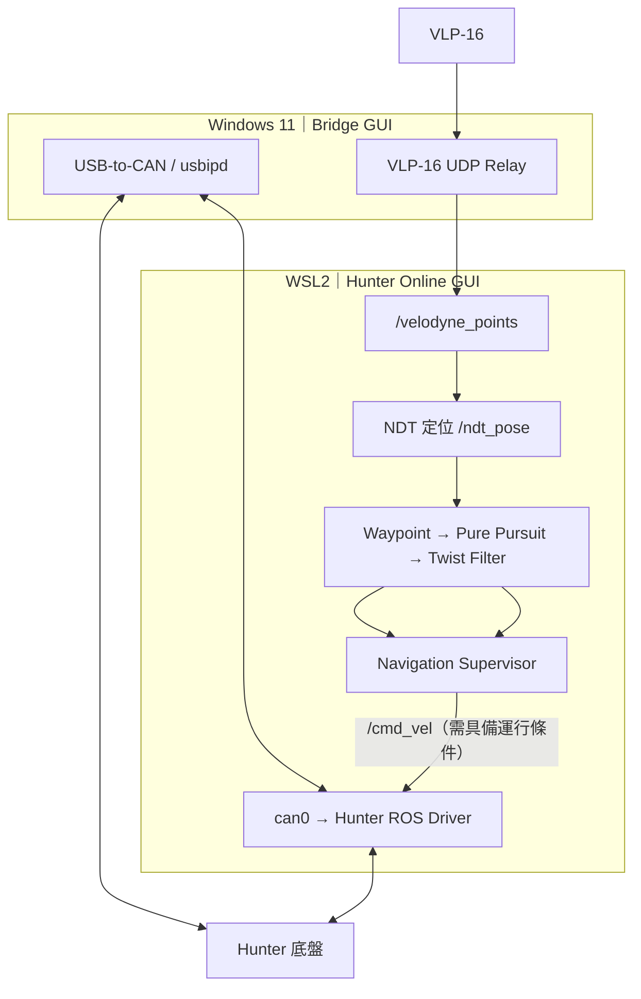

# Hunter × Autoware-Lite Online｜Windows 11 + WSL2 雙 GUI 操作教學（v1.5.8）

這份專案說明 Hunter 移動機器人在 **Windows 11 / WSL2（Ubuntu 18.04、ROS Melodic）** 下的 CAN、VLP-16、NDT 建圖／定位與 Waypoint 路徑跟隨。教學設計給第一次接手的使用者，並與 [Autoware-Lite 離線版](https://github.com/SeaFu/autoware-lite) 分開。

**最短閱讀路線**：已有可用 CAN 核心與 ROS 環境 → 直接看 **[第 7 節：雙 GUI](#hunter-gui)**；換新電腦但需要 CAN 核心 → 在方式 A／B **二選一**，完成後再看第 7 節。無須將每一章的手動檢查命令都執行一遍。

> [!IMPORTANT]
> - **原先第 7～10 節的手動 USB/CAN/ROS 診斷已移至第 8～11 節，僅供 GUI 無法完成檢查時排錯或查閱歷史交接紀錄。** 一般使用請直接操作兩套 GUI，不必再重跑 `usbipd list`、`candump`、`rostopic hz`、`tcpdump` 等相同檢查。
> - 本專案已在既有實驗環境實測過低速路徑跟隨與障礙停車；**v1.5.8 的完整組合、其他電腦的環境及數 m/s 高速安全性，仍需各自驗證**。GUI 顯示的目標巡航速度不等於硬體能達到的車速。
> - GUI 的「停止自主導航」**不是實體急停**；實車操作必須保留可用的實體急停、遙控接管、失聯停車及現場人員監控。

## 目錄

1. [已完成哪些測試](#1-已完成哪些測試)
2. [整體通訊架構：ROS、NDT、Twist 與 CAN](#2-整體通訊架構rosndttwist-與-can)
3. [另一台電腦是否需要重編 WSL2 核心](#3-另一台電腦是否需要重編-wsl2-核心)
4. [Windows 11：安裝 USBIPD（只需一次）](#4-windows-11安裝-usbipd-並確認設備)
5. [方式 A：沿用已編好的 CAN 核心（推薦）](#5-方式-a沿用已編好的-can-核心推薦)
6. [方式 B：從原始碼重新編譯核心（選用）](#6-方式-b從原始碼重新編譯核心選用)
7. [Windows + WSL2 雙 GUI 操作（v1.5.8）](#hunter-gui)
8. [附錄 A：USB-to-CAN 手動分享（排錯用）](#appendix-usb-can)
9. [附錄 B：WSL2 CAN 手動驗證（排錯用）](#appendix-wsl-can)
10. [附錄 C：舊版 ROS/Twist 交接資訊](#appendix-legacy-ros)
11. [附錄 D：常見問題與還原](#appendix-faq)

---

## 1. 已完成哪些測試

以下是**原實驗環境**累積的已知結果，換電腦時請在 GUI 內重新驗證，不要將原機結果直接當成新機通過。

| 項目 | 原實驗環境結果 | 對應 GUI 驗證 |
| --- | --- | --- |
| WSL2 CAN 核心 | 曾使用 `5.15.167.4-microsoft-standard-WSL2+`，CAN/gs_usb 編入核心 | 核心安裝參考第 5／6 節；CAN 接收看 WSL2 00 頁 |
| USB-to-CAN | candleLight / OpenMoko `1d50:606f`，Windows `usbipd` 掛載成功 | Windows Bridge「掃描／Attach」 |
| CAN 位元率與狀態 | 原機測試為 `can0`、500000 bps，能收到封包 | WSL2 00「啟動 can0」「讀取 8 筆 CAN」 |
| Hunter ROS Driver | 曾成功接收 `/hunter_status`、`/odom` 並做低速人工控制測試 | WSL2 00「啟動 Hunter Driver」 |
| VLP-16 | Windows UDP Relay 傳至 WSL2，ROS `/velodyne_points` 可更新 | Windows Relay `Forwarded` ＋ WSL2 00 Topic Hz |
| NDT Mapping | 已成功輸出 PCD 地圖 | WSL2 02 頁 |
| NDT Matching | 已顯示 PCD、即時 VLP-16 與 Hunter NDT 位姿 | WSL2 03 頁 |
| Waypoint 跟隨 | 原機曾完成自主路徑跟隨，障礙停車／恢復經後續程式調整 | WSL2 04 頁；v1.5.8 與高速狀態須另行實測 |

## 2. 整體通訊架構：ROS、NDT、Twist 與 CAN

**Windows 與 WSL2 各有一個 GUI，但硬體分成兩條獨立資料路徑**：

- **CAN**：Hunter → USB-to-CAN → Windows USB → `usbipd-win` → WSL2 `can0` → Hunter ROS Driver；車體速度命令由 ROS Driver 向底盤傳遞。
- **VLP-16**：LiDAR Ethernet / UDP 2368 → Windows UDP Relay → WSL2 Velodyne Driver → `/velodyne_points` → NDT Mapping／Matching。



> 原先的 `twiststamp` 是 `/twist_cmd` → `/cmd_vel` 的 ROS 訊息轉換範例，**不是直接對 CAN 送封包的程式**。目前的線上 GUI 使用獨立的導航橋接／Supervisor 與 Hunter ROS Driver；不要同時啟動第二套向 `/cmd_vel` 發布命令的控制流程。

## 3. 另一台電腦是否需要重編 WSL2 核心？

**一般不需要。**如果新電腦也是 **Windows 11 + x86-64 WSL2**，可以優先複製已編好的 `bzImage-can`，再在新電腦的 `.wslconfig` 指定它。

但以下幾種情況要重新編譯或另外確認：

| 情況 | 建議 |
| --- | --- |
| 新電腦同樣為 x86-64、WSL2 可啟動，USB-to-CAN 相同 | **先使用既有 `bzImage-can`**，依第 5 節驗證 |
| 新電腦是 ARM64 | **不能直接使用此 x86-64 核心**；需找對應架構及驅動 |
| WSL 更新後不相容、啟動失敗或其他裝置驅動缺失 | 還原原本 `.wslconfig`，再評估依新版本核心重編 |
| 使用不同的 USB-to-CAN 晶片／驅動 | 須檢查對應 Linux 驅動，不保證 `CONFIG_CAN_GS_USB=y` 能支援 |
| 想確保可以從原始碼重現環境 | 使用第 6 節的自行編譯流程 |

> [!IMPORTANT]
> **WSL 的 Ubuntu 檔案系統與 WSL 核心不是同一件事。**
>
> `wsl --export Autoware-18.04 ...tar` 會備份發行版檔案系統，**不會自動把 Windows 的 `.wslconfig` 或這個自訂核心一起打包**。
>
> `.wslconfig` 是**整台 Windows 主機所有 WSL2 發行版共用**，不是只影響 `Autoware-18.04`。設定之前請保留原本的檔案。

### 已有核心的檔案資訊

提供的 `bzImage-can` 經檔案辨識為：

```text
Linux kernel x86 boot executable, bzImage
version: 5.15.167.4-microsoft-standard-WSL2+
arch: x86-64
```

本次提供檔案的 SHA256：

```text
b8dcad5d360146fe488f168d1c96f8136945990d4859f55aa7dba8d1a930be81
```

**建議透過你自己保存的檔案或可信任的交接管道將 `bzImage-can` 複製到新電腦；不要從不明網站下載別人編譯的核心。**

本倉庫主要保留文件與設定方法，**不把這個未附完整對應原始碼／編譯設定紀錄的核心執行檔直接上傳成公開可下載的發行版本**。

## 4. Windows 11：安裝 USBIPD 並確認設備

如果已有可正常執行的 `usbipd`，**略過安裝，直接做第 4.2 節**。

### 4.1 安裝 `usbipd-win`（二選一）

**方式 A：Windows 安裝精靈（初學者推薦）**

1. 到官方 [usbipd-win Releases](https://github.com/dorssel/usbipd-win/releases)。
2. 下載對應 Windows x64 的 `.msi` 安裝檔。
3. 執行安裝程式，依畫面完成安裝。
4. 安裝後**重新開啟** Windows CMD。

**方式 B：Windows 套件管理員（已熟悉 `winget` 者使用）**

在 **Windows CMD／PowerShell** 執行：

```powershell
winget install --interactive --exact dorssel.usbipd-win
```

兩種方式**只要完成其中一種，不必再執行另一種**。

**確認成功：**

```powershell
usbipd --version

usbipd list
```

- 第一個指令顯示版本號，而不是「`usbipd` 不是內部或外部命令」。
- 第二個指令顯示 `BUSID`、`VID:PID`、`DEVICE`、`STATE` 欄位。

### 4.2 找到 Hunter 的 USB-to-CAN（僅排錯：正常使用 Windows GUI）

正常使用請直接開啟 **Windows Bridge GUI → 掃描 USB-CAN**，不需要執行以下命令。僅 GUI 無法辨識設備時，才將 USB-to-CAN 接到 Windows 筆電 USB 埠並開啟**系統管理員 PowerShell**進行排錯：

```powershell
usbipd list
```

原機的**輸出範例**：

```text
BUSID  VID:PID    DEVICE                            STATE
2-5    1d50:606f  candleLight (USB to CAN adapter) Not shared
```

你新電腦的 `BUSID` 可能是 `1-3`、`2-5` 或其他數字。**請以實際畫面上的 `1d50:606f` 那一行為準，不能直接照抄 `2-5`。**

如果看不到轉接器：

1. 確認 USB 線材與裝置供電。
2. 重新插拔，再執行一次 `usbipd list`。
3. 開啟 Windows 裝置管理員確認有沒有辨識到裝置。

## 5. 方式 A：沿用已編好的 CAN 核心（推薦）

**只有手上已有相容的 `bzImage-can`，才執行此節；成功後直接跳到第 7 節的 GUI 流程，不必再做後方附錄的手動 CAN 驗證。**

### 5.1 將核心檔案放到新電腦

在 Windows 檔案總管建立：

```text
D:\WSLKernel\
```

將交接取得的核心檔複製到：

```text
D:\WSLKernel\bzImage-can
```

如果你把核心放在 C 槽或其他資料夾，後面 `kernel=...` 的設定也必須跟著更改。

在 **Windows PowerShell** 確認檔案存在，並檢查 SHA256：

```powershell
Test-Path 'D:\WSLKernel\bzImage-can'

Get-FileHash 'D:\WSLKernel\bzImage-can' -Algorithm SHA256
```

**成功判斷：**

- `Test-Path` 顯示 `True`。
- SHA256 與第 3 節列出的值一致。若不一致，先核對檔案來源，**不要直接啟用**。

### 5.2 設定 Windows 共用的 `.wslconfig`

在**Windows PowerShell** 輸入：

```powershell
notepad "$env:USERPROFILE\.wslconfig"
```

若記事本詢問是否新增檔案，選擇「是」。

如果檔案原本已存在，先備份或另外存成 `.wslconfig.backup`，**不要覆寫其他既有設定**。

在 `[wsl2]` 段落加入或修改以下一行：

```ini
[wsl2]
kernel=D:\\WSLKernel\\bzImage-can
```

請注意：

- `kernel` 使用**Windows 絕對路徑**，不是 `/mnt/d/...`。
- `.wslconfig` 中的 `\` 請依範例寫成 `\\`。
- 如果檔案已經有 `[wsl2]`，**不要建立第二個相同的區段**；只加入 `kernel` 設定即可。
- 記事本儲存時，檔名必須是 `.wslconfig`，**不是 `.wslconfig.txt`**。

### 5.3 重新啟動 WSL 核心並驗證

先儲存正在執行的 WSL 工作。在 **Windows CMD 或 PowerShell** 輸入：

```powershell
wsl --shutdown

wsl -d Autoware-18.04
```

> [!WARNING]
> `wsl --shutdown` 會關閉**所有** WSL2 發行版與正在執行的 Linux 工作，不是只重啟 `Autoware-18.04`。

若你匯入的發行版名稱不同，請先用 `wsl --list --verbose` 確認，並把上方 `Autoware-18.04` 換成實際名稱。

進入 **Ubuntu 終端機**後輸入：

```bash
uname -r

zcat /proc/config.gz | grep -E '^CONFIG_CAN=|^CONFIG_CAN_RAW=|^CONFIG_CAN_DEV=|^CONFIG_CAN_GS_USB='
```

原機的**預期輸出**：

```text
5.15.167.4-microsoft-standard-WSL2+
CONFIG_CAN=y
CONFIG_CAN_RAW=y
CONFIG_CAN_DEV=y
CONFIG_CAN_GS_USB=y
```

如果顯示以上內容，代表正在使用自訂 CAN 核心，可以直接繼續第 7 節的雙 GUI 操作。**此時 `can0` 還未必存在**，因為 USB 裝置可能尚未掛載到 WSL。

`CONFIG_CAN_GS_USB=y` 的 `y` 表示**已編入核心**，所以不需要再執行 `sudo modprobe gs_usb`。原本看到 `Module gs_usb not found` 並不代表內建驅動失效。

## 6. 方式 B：從原始碼重新編譯核心（選用）

**方式 A 能成功就不用做這一節。**只有核心檔遺失、版本／架構不相容，或需要重現編譯過程時，才往下執行。

以下以原機曾使用的 Microsoft WSL2 **`5.15.167.4`** 系列為例，適用於 x86-64 的 Ubuntu WSL。其他版本請先確認對應 tag、配置格式與編譯相依套件，**不可直接把新版本核心的設定指令混用**。

### 6.1 在 Ubuntu 安裝編譯工具

```bash
sudo apt update

sudo apt install -y \
  git build-essential flex bison bc \
  libssl-dev libelf-dev dwarves cpio
```

**成功判斷：**安裝命令沒有 `E: Unable to locate package` 或其他失敗訊息。

### 6.2 下載 Microsoft 對應版本核心原始碼

```bash
git clone --depth 1 \
  --branch linux-msft-wsl-5.15.167.4 \
  https://github.com/microsoft/WSL2-Linux-Kernel.git \
  ~/wsl2-can-kernel

cd ~/wsl2-can-kernel

git describe --tags --exact-match
```

**成功判斷：**最後一行顯示 `linux-msft-wsl-5.15.167.4`。

如果 `~/wsl2-can-kernel` 已存在，不要直接刪除或覆寫；先檢查其 Git 狀態與版本。官方來源：[Microsoft WSL2-Linux-Kernel](https://github.com/microsoft/WSL2-Linux-Kernel)。

### 6.3 以 Microsoft 的 WSL 核心設定為基礎，加入 SocketCAN

請確定目前在 `~/wsl2-can-kernel`：

```bash
cp Microsoft/config-wsl .config

scripts/config --enable CAN
scripts/config --enable CAN_RAW
scripts/config --enable CAN_DEV
scripts/config --enable CAN_GS_USB

make olddefconfig
```

這四項功能分別是：

| 核心設定 | 功能 |
| --- | --- |
| `CONFIG_CAN=y` | Linux CAN 協定核心 |
| `CONFIG_CAN_RAW=y` | 使用 SocketCAN Raw Socket（如 `candump`） |
| `CONFIG_CAN_DEV=y` | CAN 網路裝置支援 |
| `CONFIG_CAN_GS_USB=y` | `gs_usb`／candleLight 類 USB-to-CAN 驅動 |

確認設定確實成功：

```bash
grep -E '^CONFIG_CAN=|^CONFIG_CAN_RAW=|^CONFIG_CAN_DEV=|^CONFIG_CAN_GS_USB=' .config
```

**四項均應為 `=y`。**如果出現 `=m` 或某項不見，請先檢查相依選項，不要直接編譯。使用 `=y` 可以避免不同 WSL 發行版找不到對應 `.ko` 模組的問題，但也表示日後更新核心要重新處理版本相容性。

### 6.4 編譯與匯出核心

```bash
make -j2 bzImage

ls -lh arch/x86/boot/bzImage

file arch/x86/boot/bzImage
```

**成功判斷：**`make` 結束沒有 `Error`，且 `arch/x86/boot/bzImage` 存在、`file` 顯示 Linux kernel x86 boot executable。

`-j2` 是較保守的並行數量，可降低 WSL 記憶體不足的風險。效能較好的電腦可以自行調整。

如果 D 槽存在並已掛載：

```bash
mkdir -p /mnt/d/WSLKernel

cp arch/x86/boot/bzImage /mnt/d/WSLKernel/bzImage-can

sha256sum /mnt/d/WSLKernel/bzImage-can
```

**注意**：此處新編譯的 SHA256 **不一定和第 3 節提供的舊核心相同**；該值只用於驗證同一份檔案是否正確複製，不能強求重建後位元組完全一致。

接著回到 **[5.2 設定 `.wslconfig`](#52-設定-windows-共用的-wslconfig)**，完成 `wsl --shutdown`、`uname -r` 與 CAN 功能檢查。

> [!TIP]
> 你原先執行的 `cp -n` 代表**目標檔案已存在時不覆寫**。重新編譯新核心時，請另外命名，例如 `bzImage-can-test`，先保留目前可運作的 `bzImage-can` 作為回復版本。

<!-- HUNTER-GUI-V158-BEGIN -->
<a id="hunter-gui"></a>
## 7. Windows + WSL2 雙 GUI 操作（v1.5.8）

完成 **[方式 A](#5-方式-a沿用已編好的-can-核心推薦)** 或 **[方式 B](#6-方式-b從原始碼重新編譯核心選用)** 其中一種後，從這一節繼續。**已有可用的 WSL2 CAN 核心、Hunter ROS 和 Autoware.AI 時，直接使用 GUI，不需重新安裝或編譯。**

### 7.1 第一次使用：確認必要檔案與環境

GitHub 儲存庫內應有以下目錄（**README 本身不會安裝 GUI，請連同 `gui/` 檔案一起上傳至 GitHub**）：

```text
autowareXhunter-lite/
├── README.md
├── gui/
│   ├── Windows_Bridge/
│   │   ├── hunter_bridge_gui.ps1
│   │   └── udp_relay.ps1
│   └── WSL2/
│       ├── hunter_online_gui.py
│       ├── aw_gui_core.py
│       ├── offline_nav_bridge.py
│       ├── hunter_nav_supervisor.py
│       ├── hunter_motion_test.py
│       ├── *.rviz
│       └── launch/
└── docs/
    ├── GUI_一次性環境準備.md
    ├── GUI_雙平台操作教學.md
    └── GUI_故障排除.md
```

| 軟體 | 功能 | 何時處理 |
| --- | --- | --- |
| Windows 11 / `usbipd-win` | USB-CAN 裝置轉交 WSL2 | 第一次使用時安裝；可參考第 4 節 |
| WSL2 Ubuntu 18.04 + CAN 核心 | SocketCAN `can0` | 第 5／6 節二選一；重開機不必重編 |
| ROS Melodic、Hunter ROS、Velodyne、Autoware.AI | LiDAR／底盤 Driver、NDT、Pure Pursuit | 第一次環境建置；已有可用環境可略過 |
| Windows Bridge／WSL2 GUI | 每天啟動與檢查 | 透過 GUI 操作，不必手動重跑底層測試 |

若還未安裝 ROS／Autoware，可參考 [一次性環境準備](docs/GUI_一次性環境準備.md)。這些環境套件**不包含**在 GUI 程式包內。

### 7.2 每次開機：Windows Bridge GUI

在 Windows 專案根目錄開啟 PowerShell，執行**唯一必要的 GUI 啟動指令**：

```powershell
powershell.exe -NoProfile -ExecutionPolicy Bypass -File ".\gui\Windows_Bridge\hunter_bridge_gui.ps1"
```

若 `.cmd` 被 Windows 關聯到記事本，直接使用上方指令即可。Windows GUI 請依序操作：

1. **掃描 USB-CAN**：確認找到 candleLight `1d50:606f`；若尚未 Shared，才按 **Bind（管理員）**。
2. **Attach CAN**：將 USB-to-CAN 分享給 WSL2；確認 Windows GUI 顯示 `Attached`。**不必另開 Terminal 執行 `usbipd list`。**
3. **自動取得 WSL IP**：重啟 WSL2 後 IP 可能變動，請重新取得。
4. **Start Relay**：VLP-16 UDP 預設 Port `2368`；以設備實際 IP 為準。確認 `Forwarded` 數量持續增加。**不必另開 `tcpdump`**。
5. **安裝／更新 WSL GUI**：**只在第一次或 GitHub 程式更新後按一次**，會整包複製 `gui/WSL2` 至 `~/hunter_online_gui/`，避免漏掉相依 Python／launch／RViz。
6. **開啟 WSL GUI**：下次沒有更新程式時直接開啟，不需要重新安裝。

> Windows Bridge 請保持開啟，因為它管理 UDP Relay。**Attach CAN 成功不代表 CAN 已收到封包**；這件事交給 WSL2 00 頁檢查。

### 7.3 WSL2 GUI：00～05 分頁

| 分頁 | 正常操作 | 在 GUI 上確認什麼 |
| --- | --- | --- |
| **00 設備總覽** | 啟動 ROS Master → 啟動 `can0`（原機 500000 bps）→ 讀取 8 筆 CAN → 啟動 Hunter Driver → VLP-16 Driver | CAN RX、`/hunter_status`、點雲／Hunter Hz；無須額外 `candump`、`roscore`、`rostopic hz` |
| **01 專案／TF** | 選擇 PCD 路徑、設定 `base_link → velodyne` 實測外參 → 套用／檢查 TF | 地圖與光達座標是否一致 |
| **02 NDT 建圖** | 開始線上建圖 → 開啟建圖 RViz → 儲存 PCD | `/ndt_map` 與 Live VLP-16；成功輸出 PCD 地圖 |
| **03 NDT 定位** | 載入 PCD → 開始線上定位 → 開啟定位 RViz | `/points_map`、`/velodyne_points`、`/ndt_pose` 持續更新並對齊 |
| **04 Waypoint／路徑測試** | 選擇 Waypoint CSV、設定巡航速度／Pure Pursuit 參數 → 開啟導航 RViz → 開始／停止導航 | 地圖、即時點雲、Hunter 位置、路徑與控制狀態 |
| **05 ROS Bag** | 需要記錄時才開始／停止 Bag | 錄製狀態與正常封存 |

04 頁在**開始導航前**可以調整：

- **目標巡航速度**：`0.05～5.00 m/s`，是設定值，不保證底盤實測能到達。
- **Lookahead Ratio**：預設 `2.0`。
- **Min Lookahead**：預設 `1.5 m`。

Pure Pursuit、障礙物暫停／清除後續行及 NDT 自適應降速由導航模組處理；但這些保護與前向 LiDAR ROI **不是完整的高速避障認證**。在開始自主導航前，必須確認底盤實際能力、可靠的實體急停／遙控接管、定位更新、行駛空間及失聯停車機制。

### 7.4 每日最短流程與異常排查

**正常情況只要兩個 GUI**：Windows Bridge「掃描、Attach、取得 WSL IP、Start Relay、開啟 WSL GUI」→ WSL2 00 頁完成 CAN／Hunter／VLP-16 → 按需求使用 01～05 分頁。**已有可用環境時不必重編核心，也不必重做 Terminal 端的 CAN／ROS 驗證。**

僅當 GUI 顯示故障、要追查驅動或 Topic 問題時，才看後面的手動診斷附錄：

- [附錄 A：USB-CAN 手動掛載](#appendix-usb-can)
- [附錄 B：WSL2 CAN 接收診斷](#appendix-wsl-can)
- [附錄 C：舊版 ROS/Twist 交接](#appendix-legacy-ros)
- [附錄 D：故障還原](#appendix-faq)

進一步的 GUI 操作與故障情況，可參考 [雙平台詳細教學](docs/GUI_雙平台操作教學.md)、[GUI 故障排除](docs/GUI_故障排除.md)。

---
<!-- HUNTER-GUI-V158-END -->

<a id="appendix-usb-can"></a>
## 8. 附錄 A：USB-to-CAN 手動分享（排錯用）

> **正常操作已整合於第 7 節 Windows Bridge GUI。** 以下為舊版手動流程，僅 GUI 無法掛載 USB-CAN 時使用。

這一步要讓 Windows 的 USB 硬體被 WSL2 看見。**有核心，不代表已接上 USB 裝置**。

### 8.1 Windows 管理員：綁定分享

先打開一個 Ubuntu WSL 終端機，讓 WSL2 VM 保持啟動。

回到 **Windows 系統管理員 PowerShell**：

```powershell
usbipd list
```

找到 `1d50:606f` 那一列的 `BUSID`。假設此時顯示的是 `2-5`，才執行：

```powershell
usbipd bind --busid 2-5

usbipd list
```

**成功判斷：**對應裝置的 `STATE` 變為 `Shared`。

`bind` 通常只需對該裝置設定一次，設定會持續保存。換一台電腦或更換裝置後仍要重新檢查。

### 8.2 Windows 一般權限：掛載到 WSL2

在 **Windows 一般權限的 PowerShell／CMD** 執行（`2-5` 仍是範例）：

```powershell
usbipd attach --wsl --busid 2-5

usbipd list
```

**成功判斷：**`STATE` 變為 `Attached`，過程沒有 `error`。

> [!NOTE]
> `attach` **不是永久設定**；重新開機、拔插 USB、設備重置、`wsl --shutdown` 後，都可能需要重新執行。USB 被 WSL2 占用期間，Windows 通常無法同時操作該 USB 裝置。

完成後回到 WSL2 Ubuntu。

<a id="appendix-wsl-can"></a>
## 9. 附錄 B：WSL2 CAN 手動驗證（排錯用）

> **正常操作請使用 WSL2 GUI 00「啟動 can0／讀取 8 筆 CAN」。** 以下為深度排錯時的手動診斷。原交接文件當時尚未確認 bitrate；目前原機已實測使用 **500000 bps**，但新車／新設備仍須確認。

以下指令都在 **Ubuntu WSL2 終端機**執行。

### 9.1 查看 USB 是否進入 Linux

```bash
lsusb

lsusb -d 1d50:606f
```

原機曾看到：

```text
Bus 001 Device 002: ID 1d50:606f OpenMoko, Inc.
```

**成功判斷：**`lsusb -d 1d50:606f` 有顯示裝置。若只看到 Linux Foundation root hub，表示 USB 尚未順利掛載；先回去檢查 `usbipd list` 的 `STATE`。

### 9.2 查看 `can0` 網路介面

```bash
ip -br link

ip -details link show can0
```

原機曾看到：

```text
lo     UNKNOWN ...
eth0   UP      ...
can0   DOWN    <NOARP,ECHO>
```

**這是建立 `can0` 成功，但尚未啟用 CAN 介面的狀態**。其中 `DOWN` 並不是轉接器未被辨識。

如果根本沒有 `can0`，可查看診斷資訊：

```bash
dmesg | grep -Ei 'usb|gs_usb|can'
```

### 9.3 確認 CAN bitrate，才啟用介面

**必須先從 Hunter 的交接資料／實車設定確認 CAN bitrate（bps）。目前尚未確認數值，因此本文不提供可直接照抄的固定 bitrate。**

如果已確定數值，在 Ubuntu 終端機逐行執行：

```bash
read -r -p '請輸入已確認的 Hunter CAN bitrate（bps）：' CAN_BITRATE

if [[ "$CAN_BITRATE" =~ ^[1-9][0-9]*$ ]]; then
  sudo ip link set can0 type can bitrate "$CAN_BITRATE"
  sudo ip link set can0 up
  ip -details link show can0
else
  echo 'bitrate 無效；未執行任何 CAN 介面設定。'
fi
```

此處的 `ip link` 會改變本機 CAN 介面設定，**不是發送車體速度指令**。如果 bitrate 與 Hunter 不一致，即使介面變成 `UP`，仍可能無法正確接收封包或造成 CAN 錯誤。

**成功判斷：**`can0` 變為 `UP`，詳細資訊顯示所設定的 bitrate。若出現 `BUS-OFF`、大量錯誤或裝置斷線，停止測試並檢查接線、終端電阻與位元率。

### 9.4 唯讀接收 CAN 封包

若系統沒有 `candump`，先安裝：

```bash
sudo apt update

sudo apt install -y can-utils
```

開始唯讀監看：

```bash
candump can0
```

正常有 CAN 流量時，應看到不斷更新的 `can0`、CAN ID 與資料位元組，例如：

```text
can0  123   [8]  00 00 00 00 00 00 00 00
```

以上的 `123` **純屬輸出格式示意，不代表 Hunter 真正使用的 CAN ID**。

按 **Ctrl+C** 結束監看。

**成功判斷要分開：**

1. `lsusb` 有裝置：USB 分享成功。
2. `ip link` 有 `can0`：Linux CAN 裝置建立成功。
3. `candump` 確實收到 CAN 訊框：CAN 接收鏈路成功。
4. 能解析出速度／狀態與正確里程計：**仍待確認封包規格與 ROS 解碼程式**。

不需要、也不建議為了測試接收就先送出未知 CAN ID 或驅動命令。

<a id="appendix-legacy-ros"></a>
## 10. 附錄 C：舊版 ROS/Twist 交接資訊

> **以下記錄的是早期僅具 CAN 唯讀診斷時的交接觀察，不代表 v1.5.8 現況。** 目前已使用 Hunter ROS Driver 與導航 Supervisor 串接；日常導航請使用第 7 節 GUI，勿再啟動平行的 `/cmd_vel` 控制鏈。

### 10.1 目前保留的 ROS 訊息轉換程式

早期本倉庫的 [`examples/twiststamp_safe.py`](examples/twiststamp_safe.py) 是交接程式 `twiststamp` 的加強版範例：

| 項目 | ROS 介面 |
| --- | --- |
| 輸入 | `/twist_cmd`：`geometry_msgs/TwistStamped` |
| 轉換 | 保留 `twist.linear.x`、`twist.angular.z` |
| 輸出 | `/cmd_vel`：`geometry_msgs/Twist` |
| 額外防護 | 過期命令輸出零速、忽略非有限數值 |
| **不具備** | CAN 封包編碼、Hunter 連線、馬達驅動與硬體急停 |

> [!WARNING]
> 這份腳本目前是**待實測的 ROS 訊息橋接範例**，不是已驗證的安全控制器。其 `rospy.Timer` 會受到 ROS 時間設定影響，不能拿它當獨立於 `/clock` 的硬體失聯保護。真正的安全停車仍須由 Hunter 底盤控制器與外部急停機制保證。

在車體驅動完全隔離的 ROS 測試環境中，先確認 Topic：

```bash
source /opt/ros/melodic/setup.bash

rostopic type /twist_cmd

rostopic type /cmd_vel
```

**預期型別**分別為 `geometry_msgs/TwistStamped`、`geometry_msgs/Twist`。Topic 尚未發布時可能會顯示查無資訊，需先檢查 Autoware 節點是否啟動。

**只有在確認 `/cmd_vel` 沒有連接實車致動節點的隔離環境，才進行後續橋接程式測試。**

### 10.2 為什麼還要找底盤驅動？

你以前的流程是「載入 Waypoint CSV → NDT 定位 → Pure Pursuit → Twist Filter → `twiststamp` → 遙控器切自駕 → Hunter 行駛」，這是有價值的成功經驗。

但從目前掌握的 `twiststamp` 原始碼來看，**它只使用 `rospy.Publisher('/cmd_vel', Twist)`；沒有開啟 `can0` 或 `socketCAN`**。

因此曾經能動的系統裡，應該還有某個**未確認的底盤控制流程或 ROS 節點**，將 `/cmd_vel` 轉為 CAN 命令。後續需要在**舊系統可用的情況下，以唯讀方式**查核：

- 當時 `/cmd_vel` 的 subscribers 是哪些節點？
- 那個節點的 launch、原始碼或可執行檔在哪裡？
- 使用哪個 CAN 介面、bitrate、CAN ID、資料定義與安全機制？
- Hunter 的里程計／底盤狀態是由哪個節點發布？

在釐清之前，**不要直接把 `/cmd_vel` 連到任何新的 CAN 發送程式**。

### 10.3 後續測試順序

1. **硬體層**：`usbipd` → `lsusb` → `can0` → `candump`（本文件核心）。
2. **CAN 協定層**：只讀辨識 Hunter 狀態回傳、確認 bitrate 與 CAN ID。
3. **ROS 觀察層**：確認舊環境的 `/cmd_vel` subscriber、底盤狀態及 odom 節點。
4. **隔離測試層**：在不接致動輸出的情況下測 `/twist_cmd → /cmd_vel` 與 timeout。
5. **實車控制層**：完成電氣安全、軟硬體急停、斷線保護與現場監督後再制定專門 SOP。

目前 v1.5.8 的線上 GUI 已包含 CAN／VLP-16／ROS Topic 健康狀態、NDT、Waypoint、Bag 錄製等；**不需要沿用離線版的 bag 播放工作流程**。

<a id="appendix-faq"></a>
## 11. 附錄 D：常見問題與還原

### Q1：`lsusb` 有 `1d50:606f`，卻沒有 `can0`？

先檢查 `uname -r` 與 `/proc/config.gz`，確認新核心載入、`CONFIG_CAN_GS_USB=y`；再用 `dmesg` 查看設備是否正確綁定 `gs_usb`。如果只有 USB 裝置但缺 CAN 驅動，`can0` 不會出現。

### Q2：`can0` 是 `DOWN`，是不是失敗？

不一定。這表示 Linux 已建立介面，但尚未啟用。先確認 Hunter bitrate，再依 9.3 設定；不要用未知 bitrate 亂試。

### Q3：有 `can0`，但 `candump` 沒封包？

可能是位元率不符、USB-to-CAN 與 Hunter 的 CAN H／CAN L／GND 或終端電阻問題、車體未供電，或設備根本沒有在發送狀態訊息。**單靠 `can0` 無法判定是哪種原因。**

### Q4：新電腦匯入了舊機的 Ubuntu `.tar`，卻沒有 `can0`？

WSL 發行版備份不包含 Windows `.wslconfig` 與自訂 `bzImage`。請依第 5 節在**新電腦的 Windows 使用者資料夾**設定核心，並重新執行 `usbipd attach`。

### Q5：設定自訂核心後 WSL 無法啟動，怎麼恢復？

在 Windows 編輯 `%USERPROFILE%\.wslconfig`，**移除或註解 `kernel=...` 一行**（若有原本的設定，請從備份恢復），再執行：

```powershell
wsl --shutdown

wsl -d Autoware-18.04
```

這會讓 WSL 重新使用預設核心設定，**不會刪除 Ubuntu 發行版**。恢復後再檢查 custom kernel 的架構與相容性。

### Q6：為什麼 `sudo modprobe can`／`gs_usb` 出現 Module not found？

先確認 `/proc/config.gz`：

- `CONFIG_CAN_GS_USB=y`：功能已編入核心，**不需要 `modprobe`**。
- `CONFIG_CAN_GS_USB=m`：需要同版本的可載入模組；只有 `bzImage` 可能不足。
- `# CONFIG_CAN is not set`：核心未啟用 CAN，需使用已修改的核心或重新編譯。

### Q7：重開機後 USB 連線消失？

`usbipd bind` 是分享設定，`usbipd attach` 是當次掛載。電腦重啟／WSL 關閉／拔插裝置後，再以目前的 BUSID 重新 `attach`。

### Q8：如何解除 USB 分享，還給 Windows？

在 **Windows PowerShell** 執行，BUSID 請換成目前看到的值：

```powershell
usbipd detach --busid 2-5

usbipd list
```

如果 `bind` 已設定，`STATE` 通常會回到 `Shared`，但不再是 `Attached`。

---

## 參考資料

- [Microsoft Learn｜Connect USB devices in WSL](https://learn.microsoft.com/en-us/windows/wsl/connect-usb)
- [usbipd-win｜官方專案與 WSL 使用說明](https://github.com/dorssel/usbipd-win/wiki/WSL-support)
- [Microsoft Learn｜`.wslconfig` 自訂核心設定](https://learn.microsoft.com/en-us/windows/wsl/wsl-config)
- [Microsoft｜WSL2-Linux-Kernel 原始碼與編譯說明](https://github.com/microsoft/WSL2-Linux-Kernel)
- [Autoware-Lite｜離線建圖與導航驗證](https://github.com/SeaFu/autoware-lite)

**紀錄原則**：歷史交接紀錄與目前 GUI 狀態應分別標示；僅將已經過實機驗證的功能寫成「已完成」。V1.5.8 或新電腦未經完整驗證的功能仍標示為「待實測」。
